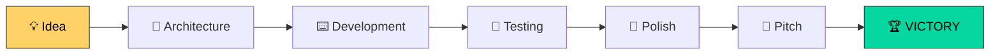

# FitPath

### *Make your mistakes in the twin, not in the store.*

**FitPath is the digital twin of a fast-fashion store: test promotions, layouts and staffing on the twin's shoppers before you try them on your real customers.**


---

## What it does

A store cannot be A/B tested. Store managers pick promotions, department layouts and staffing on gut feeling, and a mistake only shows up at the end of the season. FitPath turns real sales data into a living 3D store where you can try an idea first and see what it is worth, with an error margin.

- **Real data.** 31.8 million H&M transaction rows (Kaggle, Sep 2018 – Sep 2020). Every simulated day replays the real receipts of that day.
- **Customer profiles.** 7 shopper profiles from clustering the real customers (store regulars, premium ladies, young Divided, big basket, and more).
- **A 2,000 m² 3D store.** Every shopper walks, browses, tries on in the fitting rooms and queues at the tills. About 9 seconds to simulate a full store day with ~2,800 shoppers.
- **Strategy experiments.** Extra tills, fitting-room attendants, discounts, 3-for-2, end-of-season sales, bundles, window displays, cross-merchandising, moved departments. Each one is tested against the baseline on the same shoppers, with replications and a 90% interval, and gets a verdict: worth it, not worth it, or uncertain.
- **Layout optimizer.** Explores the 3,024 department layouts allowed by the store rules with a neural-network-guided tabu search, then verifies the best ones in the twin.
- **An agent.** An LLM agent running on AMD reads the real data, proposes strategies, runs them in the twin and explains the results. It orchestrates tools and explains; it does not make the forecast.
- **Explained forecasts.** Demand forecast with a measured backtest (12.0% average daily error on 8 unseen weeks), not an LLM guess.
- **Privacy by design.** No faces, only x, y, t. Each receipt is matched to an anonymous track, never to a person.

Example: on Black Friday 2019 an extra till from 12:00 to 20:00 was worth **+€3,548 net** in one weekend (90% interval €2,301 – €4,795), after paying the extra staff. The twin knew it first.

## How it works

Historical data → insights → the LLM proposes strategies with concrete levers → the twin tests them on a future period (forecast demand) against the baseline, with replications and a confidence interval → the LLM comments and proposes a variant.

```
backend/fitpath/
  data/ingest.py        H&M CSVs (zipped is fine) -> Parquet
  analytics/real.py     insights on the real data: seasonality, baskets, trends, sales, weekdays
  personas.py           customer profiles from clustering
  sim/                  layout, real demand, simulation engine, reports
  llm/                  advice (AMD Token Factory, any OpenAI-compatible endpoint, or Gemini)
  api.py                FastAPI API
frontend/               React dashboard (Data, My store, Strategies, Plan)
```

```
backend/fitpath/
  forecast.py           demand forecast (previous year corrected for the trend) + backtest
  elasticity.py         price elasticity per zone (with an interval when the data is not enough)
  sim/strategy.py       levers: extra till, fitting-room attendant, moved departments, discounts, 3-for-2, sales, bundles, window display, cross-merchandising
  sim/experiment.py     baseline vs strategy, common random numbers, parallel replications, 90% CI
  sim/search.py         constrained generation + neural ranking + verification
```

1. **Data**: H&M CSVs converted to Parquet and queried with DuckDB.
2. **Analytics**: seasonality, baskets, 7 customer profiles (KMeans), forecast with backtest, price elasticity.
3. **Twin**: agent-based simulation with a 1-second step. Shoppers walk on a grid with A* paths, try clothes on and queue at fitting rooms and tills. Each day's buyers are the real H&M receipts of that day; the store plan is a data file.
4. **Experiments**: baseline vs strategy with common random numbers (same shoppers, same choices), parallel replications, 90% interval.
5. **Optimizers**: constrained search over lever combinations, an ensemble of MLPs, tabu search for departments, verification in the twin.
6. **Agent + UI**: LLM with tools, saved conversations and approval for long simulations; React dashboard with a Three.js 3D store.

**The store (2,000 m², H&M style):** the floor plan is a data file (`backend/fitpath/sim/store_plan.py`): a 50 × 40 m floor with a decompression zone at the entrance, window displays, 8 departments (New in, Ladies, Divided, Men, Kids, Denim, Basics, Accessories) in 8 blocks, 8 fitting rooms near Ladies, 6 tills near the exit, columns and 27 cameras. The fixtures of each department are generated from the department type and the shape of the block, so moving a department only means changing the department → block assignment.

## Quick start

**1. Data**: download `articles.csv`, `customers.csv`, `transactions_train.csv` from [Kaggle H&M](https://www.kaggle.com/competitions/h-and-m-personalized-fashion-recommendations/data) (the zip files are fine) into `data/raw/`.

**2. Backend** (Python 3.12+)

```bash
python -m venv .venv
.venv/Scripts/python -m pip install -r backend/requirements.txt
cp .env.example .env        # optional: AMD_API_KEY (or GEMINI_API_KEY) for the agent and LLM advice
cd backend
../.venv/Scripts/python -m fitpath.data.ingest            # ~30 s
../.venv/Scripts/python -m fitpath.analytics.real         # ~5 s
../.venv/Scripts/python -m fitpath.personas               # ~1 min
../.venv/Scripts/python -m uvicorn fitpath.api:app --port 8000
```

**3. Frontend**

```bash
cd frontend
npm install
npm run dev                  # http://localhost:5173
```

A simulation can also be run from the command line: `python -m fitpath.sim.engine --start 2019-11-25 --days 7 --size medium` (`--size` is the store traffic: low, medium, high).

## Runs on AMD

The LLM behind the agent and the advice runs on **AMD Token Factory**, an OpenAI-compatible API serving models on AMD GPUs. The default model is **DeepSeek-V4-Flash**, with **Qwen3.8-Flash-Next** as fallback. Configure it in `.env`:

```bash
LLM_PROVIDER=amd
AMD_API_KEY=...
AMD_BASE_URL=https://developer.amd.com.cn/radeon/api/v1
AMD_MODEL=DeepSeek-V4-Flash
AMD_FALLBACK_MODELS=Qwen3.8-Flash-Next
```

Any other OpenAI-compatible endpoint (for example vLLM on ROCm) or Gemini also works with `LLM_PROVIDER=openai|gemini`. The simulation itself runs on CPU.

## The agent

**Agent (Strategies page):** a chat on the right with an LLM agent (AMD Token Factory by default; with `LLM_PROVIDER=openai|gemini` the models come from `AGENT_MODELS` in `.env`), structured like the opencode harness: saved conversations, messages made of parts, tools shown as blocks with status and result, approval for long simulations. Tools in `backend/fitpath/agent/tools.py`: real data, forecast, store analysis, strategy testing, optimizer, 3D preview, suggestions, plan, store notes (which become constraints for the simulations). In the centre, the 3D twin shows the simulated peak day with the strategy applied (tables moving, promotion signs); on the left, the suggestions panel.

## Strategies and the layout optimizer

**Strategies (the heart of the twin):** history → insights → the LLM proposes strategies with concrete levers → the twin tests them on a future period (forecast demand) against the baseline, with replications and a confidence interval → the LLM comments and proposes a variant. "Explore variants" generates every lever combination allowed by the constraints, simulates a sample, ranks them with an ensemble of neural networks (MLP) and the twin verifies the best ones.

```bash
../.venv/Scripts/python -m fitpath.elasticity                                  # once
../.venv/Scripts/python -m fitpath.forecast --cutoff 2020-06-29 --days 56      # forecast backtest
../.venv/Scripts/python -m fitpath.sim.search --start 2020-09-25 --days 3      # search from the command line
```

**Layout optimization** (`sim/layout_opt.py`, agent tool `optimize_layout`): a block approach after Ozgormus. The rules (New in visible from the entrance, Ladies near the fitting rooms, space proportional to sales) leave 3,024 allowed layouts; the twin simulates a sample, an ensemble of MLPs learns "layout features → incremental margin" (exposure, adjacencies, path, space), a tabu search over department swaps finds the best candidates and the twin verifies the top 3 with replications and a 90% interval. In the 3D view, the moved departments are taken apart and rebuilt in their new block.

```bash
../.venv/Scripts/python -m fitpath.sim.layout_opt --start 2020-09-25 --days 2     # layout optimization from the command line
```

## In-store behaviour model and sources

**In-store behaviour from the literature** (`sim/behavior.py`, section "The store and the model's assumptions" on the My store page): position attractiveness (end caps and window displays, Tan et al. 2018; Underhill), unplanned purchases along the path (Hui et al. 2013), adjacent departments bought together from the lift of the H&M baskets (Ozgormus 2015), crowding that reduces purchases (Hui, Bradlow & Fader 2009), fitting-room attendant (+2.1% conversion, Kesavan), non-optimal paths (Hui, Fader & Bradlow 2009). Every parameter is a range: each simulation draws its own values, so the replications include the model's uncertainty.

| Effect | Range used | Source |
|---|---|---|
| Position attractiveness | from ×0.6 (back wall) to ×1.7 (visible from the entrance) | Tan, Corsi et al. 2018 (Flinders/Ehrenberg-Bass); Underhill, *Why We Buy* |
| Purchases along the path | 0.6–1.8% per department crossed | Hui, Inman, Huang & Suher 2013, *Journal of Marketing* |
| Adjacent departments bought together | 2–6% per lift above average | Ozgormus 2015, Auburn University |
| Crowding | from −10% to −25% per extra person every 10 m² above the threshold | Hui, Bradlow & Fader 2009, *Journal of Consumer Research* |
| Fitting-room attendant | from +1% to +3% on items tried on | Kesavan et al., pilot on 10 stores (+2.1% conversion) |
| Non-optimal paths | 20–40% of choices do not go to the nearest department | Hui, Fader & Bradlow 2009 |
| Price elasticity | from −2.0 to −0.6 (central −1.2) | not derivable from the H&M data: conservative range |

---

# 🔥 LET'S GO! 🔥

# 🚀 AMD HACKATHON 2026 🚀

### *We are not here to take part. We are here to win.*


```
   ╔═══════════════════════════════════════════╗
   ║   IDEA  ➜  CODE  ➜  DEMO  ➜  VICTORY      ║
   ╚═══════════════════════════════════════════╝
```


---


## 🔥 Our mission

> **Turn an idea into something real, in a few hours, together.**

Every great project started with a group of people who decided to give it a shot.
We are that group.

---


## 💪 Why we will win


| ⚡ Speed                                                  | 🧠 Brains                           | ❤️ Team                      | 🎯 Focus                                     |
| -------------------------------------------------------- | ----------------------------------- | ---------------------------- | -------------------------------------------- |
| We iterate fast, fail fast, improve faster               | Different skills, one single vision | We always have each other's backs | One goal: a demo that leaves jaws on the floor |


---


## 🗺️ The roadmap to victory




- [ ] 💡 Define the problem and the solution
- [ ] 🧩 Split the tasks
- [ ] ⌨️ Build the MVP
- [ ] 🧪 Test everything (even at 3 a.m.)
- [ ] 🎨 Polish the demo
- [ ] 🎤 Prepare a memorable pitch
- [ ] 🏆 Take the stage

---


## 📜 Team rules

1. **Ship it.** A working MVP beats a perfect idea.
2. **Communicate.** A blocker shared is a blocker halved.
3. **Commit often.** Small steps, big results.
4. **No ego.** The team wins, not the individual.
5. **Have fun.** We work better when we enjoy it.
6. **Never give up.** The nastiest bug is the one that teaches you the most.

---


## 🌙 When it gets hard

```
 At 3 a.m., with a bug that will not go away,
 remember why you started.

 It is not for the prize.
 It is for the moment the demo starts
 and everything works.
```

---


## 👥 The Team


| Member           | Role          | Superpower    |
| ---------------- | ------------- | ------------- |
| 🧑‍💻 **Pietro** | *to be defined* | *to be defined* |
| 🧑‍🎨 **Diego**  | *to be defined* | *to be defined* |
| 🧑‍🔬 **Andrea** | *to be defined* | *to be defined* |
| 🧑‍🚀 **Ettore** | *to be defined* | *to be defined* |
| 🦾 **Francesco** | *to be defined* | *to be defined* |
| ⚡ **Stefano**    | *to be defined* | *to be defined* |


---


### 🏆 The future is built now. Let's build it together. 🏆

**Let's build. Let's break. Let's win.**

⭐ *Made with passion, caffeine and way too many commits* ⭐
